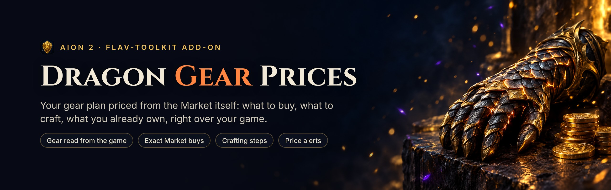
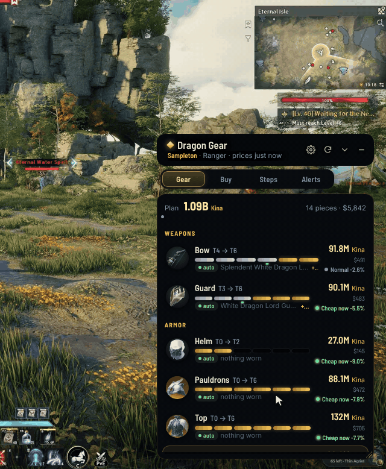
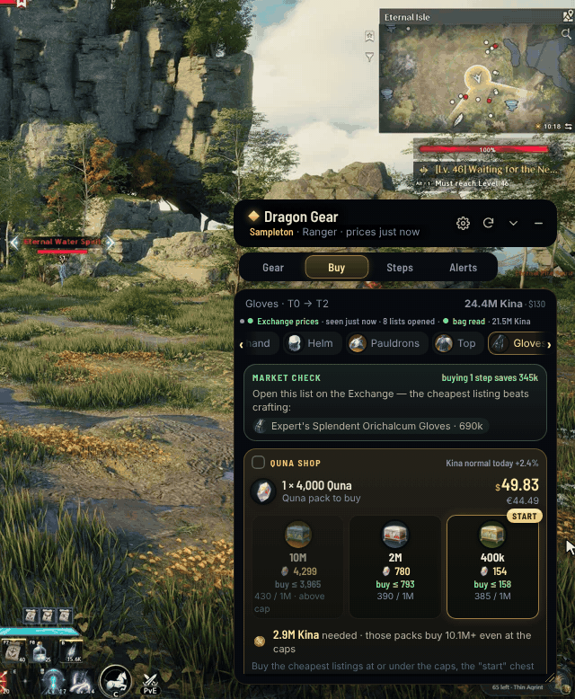
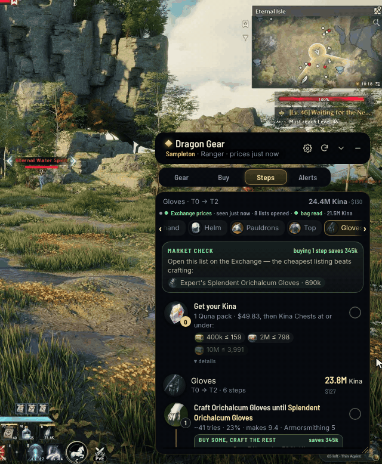
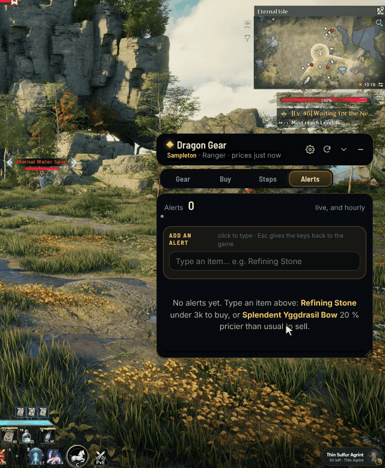
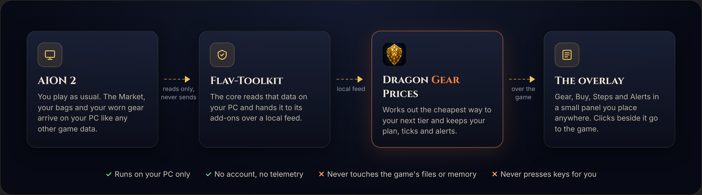

  

  
  
  
  
  

  <b>Stop adding up Dragon Gear costs in a spreadsheet.</b> 
  What your next tier costs, the cheapest listings to buy, what to craft instead, and what your bags already cover, in a small panel over your game.

---

> [!WARNING]
> **This is a fully vibe-coded side project.** It was built for fun, to make gearing up less painful. Expect bugs, rough edges and the odd wrong price. It's free, it's open, and it comes with no promises. If something breaks, [open an issue](../../issues), or better, fix it and send a pull request.

## Contents

- [What it does](#what-it-does)
- [How it works](#how-it-works)
- [Install](#install)
- [Is it safe?](#is-it-safe)
- [Troubleshooting](#troubleshooting)
- [Credits](#credits)
- [Contributing](#contributing)
- [Support](#support)

## What it does

Dragon Gear Prices is an add-on for [Flav-Toolkit](https://github.com/Flavbestlol/flav-toolkit). Four tabs in one small panel that sits over AION 2: **Gear**, **Buy**, **Steps** and **Alerts**. Drag it anywhere; clicks beside it go to the game.

### Your gear, read from the game

  

- **Nothing to type.** Log in and every slot fills itself: the tier you wear and its enchant, read from the game's own login data. Swap a piece and it shows at your next login or zone change.
- **What every tier costs**, in Kina and in your currency ($, € or SAR). Hover a bar for that tier's piece and price.
- **Own a piece you don't wear?** Click its bar. The plan and its cost follow at once, and *Back to the tier you wear* undoes it.
- **The market's mood** on every slot: cheap now, normal, or pricey against its usual price.
- Click a piece to open its shopping list.

### A shopping list that knows the Market

  

- **Prices from the Market itself** (the game's Exchange) while you play, as the game shows them to you. Open an item's list on the Exchange in game and its line becomes **exact**: the whole listings to buy, cheapest first, and the most to pay for each.
- **How to get the Kina**: how many Quna packs, then which Kina Chests (10M, 2M, 400k) to buy at or under the prices it shows.
- **What you already have** is taken off: your bag, storage and warehouse are read from the game, and a line they cover is marked *covered*. Kina in hand counts too.
- **Several pieces at once**: Ctrl+click to add one, or *All* for the whole set.
- **A verdict on every line**: pricey (better to wait), fair or cheap, against the usual price.

### Every craft, in order

  

- **Step by step**: get the Kina, then each craft in order with its cost, its tries and its materials.
- **Buy some, craft the rest.** When some listings on the Market are cheaper than crafting one more, the step says how many to buy, up to what price, how many to craft and what it saves.
- **Click a name to copy it**, then paste it in the Exchange search.
- **Tick as you go.** Ticking a step ticks the ones before it, and *one step at a time* shows just the step you're on.

### Price alerts

  

- **Any item**: a price to buy at, a price to sell at, how many are listed, or cheaper or pricier than usual by a percentage.
- **Type it right over the game.** The panel takes the keys while you type, and gives them back to the game when you're done (or press Esc).
- **Checked every time you open the Exchange in game**: the alert turns to *now*, Flav-Toolkit's dock lights up with the item's picture, and Windows shows a notification.

### And in the browser

The add-on also has a full page at `http://127.0.0.1:7317` (only on your PC), for the things that need a keyboard: your crafting levels, the leveling planner, your alerts, and the price log (`data\price-log.csv`, opens in Excel).

## How it works

  

1. **Flav-Toolkit** reads what the game already sends to your PC: the Market pages it downloads, your bags, your worn gear and who you are (name, server, class). It never sends anything to the game.
2. It hands that to its add-ons over a local feed. **Dragon Gear Prices** is a small local app (Node.js) that works out the cheapest way to each tier and keeps your plan, your ticks and your alerts.
3. The **overlay** shows it over the game. Flav-Toolkit's hub starts and stops the app for you.

When the game isn't being read, prices come from [a2-tracker.com](https://a2-tracker.com)'s public data (hourly), and your gear from the official AION 2 site.

## Install

You need **Windows 10 or 11** (64-bit), **AION 2**, and **[Flav-Toolkit](https://github.com/Flavbestlol/flav-toolkit)** with [Npcap](https://npcap.com) (Flav-Toolkit's README says how).

1. **Get the add-on.** On this page: **Code › Download ZIP**, and extract it to a folder that can stay, for example `D:\Games\Addons\Market Crafting`.
2. **Get its runtime.** Double-click `tools\get-node.bat` once. It downloads the official Node.js (one file, from nodejs.org) into `app\node\`.
3. **Add it to Flav-Toolkit.** In the hub: **+ Add a folder of add-ons**, type `D:\Games\Addons` (the folder *around* the add-on), click **Add**, then **Rescan**. *Dragon Gear Prices* shows in the sidebar: click **Start**.
4. **Play.** Start AION 2 with **Play AION 2** in Flav-Toolkit (so the Market can be read), log in, and open the panel from the dock by the minimap.

> [!NOTE]
> Signed releases are planned: then the hub installs and updates the add-on in one click, with no runtime to fetch. Until then, updating is the same three steps over your folder (your `settings.json` and `data\` stay).

<b>Without Flav-Toolkit</b>

Double-click `Dragon Gear Prices.bat`: it starts the app and opens its page in your browser. You get the plan, the shopping list and the steps with a2-tracker's hourly prices, but no overlay, no live Market prices, no bags and no gear from the game (type your character's name and pick its server to read it from the official site).

## Is it safe?

Here is exactly what it does:

- **It reads, it never plays.** No packets to the game, no key presses, no reading the game's memory, no touching its files. What it knows about the game comes from Flav-Toolkit, which reads only what the game already sends to your PC. How Flav-Toolkit reads the Market, and what it may and may not do, is written down in its [`docs/SECURITY.md`](https://github.com/Flavbestlol/flav-toolkit/blob/main/docs/SECURITY.md).
- **It runs on your PC only.** The app answers at `127.0.0.1:7317`, which nothing outside your PC can reach. Your plan, ticks, alerts and what was read from the game stay in its folder (`settings.json`, `data\`). Delete them any time.
- **No account, no telemetry, no uploads.** The only sites it asks are the ones listed in `addon.json`: [a2-tracker.com](https://a2-tracker.com) (prices, recipes and item data), the official AION 2 site (`aion2.plaync.com`, `api-search.plaync.com`: your character's name and server, only when the game isn't being read), the game's icon server (`assets.playnccdn.com`), and `open.er-api.com` (today's exchange rate, for $/€/SAR). It asks them as itself, with its own name.
- **One change outside its folder, only if you ask.** Turning on *hourly alerts* in the page adds a Windows task that starts the app hidden when you log in, so alerts keep working. Turning them off removes it.
- **It's open.** All the code is in this repository: read it, or run it from source.

> [!NOTE]
> This is a third-party fan project, not made or supported by NCSOFT or a2-tracker. Use it at your own risk.

## Troubleshooting

<b>The panel says prices are not live from the Market</b>

Start AION 2 with **Play AION 2** in Flav-Toolkit (not from the launcher alone), then open the Exchange in game. For exact buys, open the item's own list on the Exchange.

<b>My gear tiers are all empty</b>

Log in (or go back to character select and in again) with Flav-Toolkit already running: the game sends your worn gear at login. Without Flav-Toolkit, type your name and pick your server in the page, then **Read my gear**.

<b>The hub doesn't list the add-on</b>

The folder you add in the hub is the one *around* the add-on (`D:\Games\Addons`), not the add-on's own. Inside it, `Market Crafting\addon.json` must be there. Then **Rescan**.

<b>It says "app\node\node.exe" is missing</b>

Run `tools\get-node.bat` once. If the download fails, get `node.exe` from [nodejs.org](https://nodejs.org/dist/v24.22.1/win-x64/) into `app\node\` yourself.

<b>Something else is wrong</b>

[Open an issue](../../issues) with what you did, what you expected and what happened. A screenshot helps. Please blur other players' names and chat.

## Credits

- **[a2-tracker.com](https://a2-tracker.com)**: the Dragon Gear recipes, success rates, NPC prices, hourly Market prices and item data this add-on is built on.
- **[eiruuru/aion2-char-sheet](https://github.com/eiruuru/aion2-char-sheet)** (GPL-3.0): the server list.
- **[Exchange Rate API](https://www.exchangerate-api.com)**: today's rates, with no account.
- **[Node.js](https://nodejs.org)**: the runtime the app runs on.
- The banner art and the icon were made for this project with [Higgsfield](https://higgsfield.ai). The README's GIFs are drawn from the add-on's own UI with made-up data (see [`tools/readme-gifs`](tools/readme-gifs)).

AION 2 is a trademark of NCSOFT. This project isn't affiliated with NCSOFT.

## Contributing

Bug reports, ideas and pull requests are welcome. It's a side project, so answers may take a while.

- **The app** is plain Node.js with no dependencies, in [`app`](app): `server.js` (the local server), `compute.js` (the plan), `market.js` (the Market), `inventory.js`, `alerts.js`, `feed.js` (Flav-Toolkit's feed). The page is in [`app/ui`](app/ui).
- **The overlay** lives in Flav-Toolkit for now (`crates/flav-app/ui/shop.*`) and calls this app's API.
- **Tests**: `node --test app/test/*.test.js` (CI runs them on Windows and Linux).
- Never commit `settings.json`, `data\`, captures or key files: they are a player's own, and `.gitignore` refuses them.

## Support

The add-on is free and always will be. If it saved you some Kina and you'd like to say thanks, you can buy me a coffee:

No pressure: a star on this page or a bug report helps just as much.

## License

[GPL-3.0](LICENSE).
